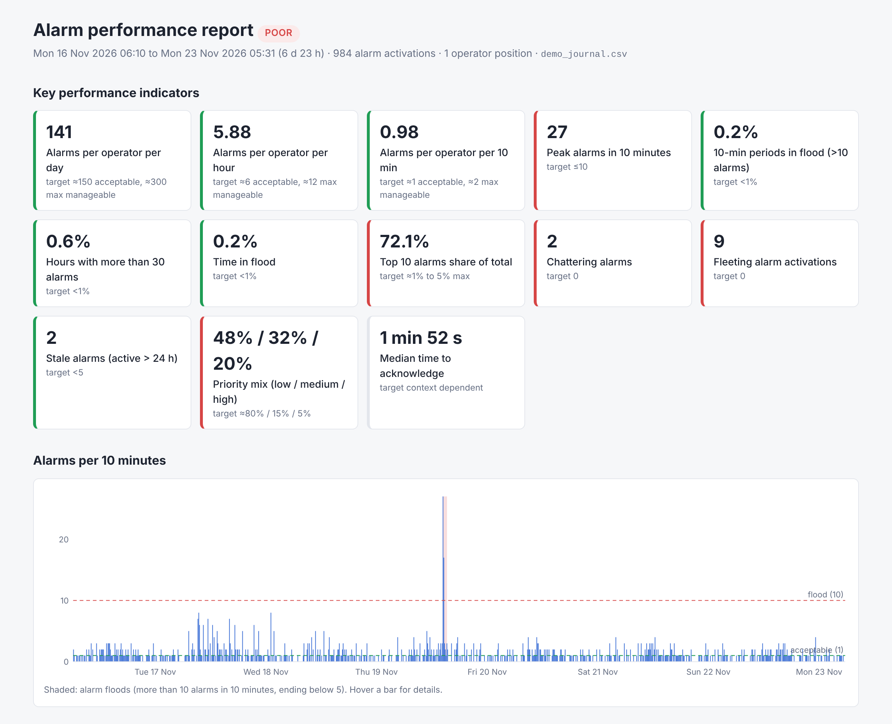

# alarmkpi

[](https://pypi.org/project/alarmkpi/)
[](https://github.com/DanShinde/alarmkpi/actions/workflows/ci.yml)
[](https://pypi.org/project/alarmkpi/)
[](LICENSE)

**Alarm performance KPIs from your alarm journal, measured against ISA-18.2 and EEMUA 191.**
Point it at a CSV export from your SCADA, HMI or DCS and get the numbers an alarm
rationalization starts with, plus a one-file HTML report you can email to the plant manager.



```console
$ pip install alarmkpi
$ alarmkpi report alarm_journal.csv --html report.html
Alarm performance: 984 alarms, 2026-11-16 06:10 to 2026-11-23 05:31 (6 d 23 h)

  OK    Alarms per operator per day                        141   target ≈150 acceptable, ≈300 max manageable
  OK    Alarms per operator per 10 min                    0.98   target ≈1 acceptable, ≈2 max manageable
  BAD   Peak alarms in 10 minutes                           27   target ≤10
  BAD   Top 10 alarms share of total                     72.1%   target ≈1% to 5% max
  BAD   Chattering alarms                                    2   target 0
  ...
Overall: POOR
```

## What it measures

| Metric | Target (one operator position) |
| --- | --- |
| Alarms per operator per day / hour / 10 minutes | ≈150 / ≈6 / ≈1 acceptable, ≈300 / ≈12 / ≈2 maximum manageable |
| Peak alarms in any 10 minutes | ≤10 |
| % of 10-minute periods in flood, % of hours with >30 alarms, % of time in flood | <1% |
| **Alarm floods**: start, duration, size, peak and main contributors | flood starts above 10 alarms / 10 min, ends below 5 |
| **Bad actors**: top 10 alarms and their share of the total load | ≈1% to 5% max |
| **Chattering** alarms (3+ activations within 60 s) | 0 |
| **Fleeting** alarms (active for less than 1 s) | 0 |
| **Stale** alarms (active more than 24 h) and alarms still standing | <5 |
| **Priority distribution** | ≈80% low / 15% medium / 5% high |
| Median time to acknowledge | reported when the journal has acknowledgements |

Every threshold is a command-line option (`--operators`, `--chatter-count`, `--chatter-window`,
`--fleeting`, `--stale-hours`, `--top`), because your alarm philosophy document has the final
say. The targets are the commonly published ISA-18.2 / EEMUA 191 figures and are guidance, not
a compliance verdict.

## Try it without plant data

```console
alarmkpi demo -o demo_journal.csv             # a realistic week: a flood, a chattering
alarmkpi report demo_journal.csv --html report.html  # level switch, stale alarms, ...
```

Or open the [sample report](https://htmlpreview.github.io/?https://github.com/DanShinde/alarmkpi/blob/main/docs/demo-report.html)
made from [`examples/demo_journal.csv`](examples/demo_journal.csv).

## Your alarm journal

Any CSV with one row per alarm event works. Columns are found by their usual names
(`EventTime`/`Timestamp`/`Time`, `Source`/`Tag`/`Alarm`, `EventState`/`State`/`Type`,
`Priority`/`Severity`, `Message`/`Description`, `Area`/`Unit`), comma, semicolon or tab
separated, UTF-8 or Windows-1252. When the names differ, say which is which:

```console
alarmkpi report events.csv --time-col "Date/Time" --tag-col "Point" --state-col "Event" \
    --priority-col "Level" --time-format "%d/%m/%Y %H:%M:%S"
```

- **State column** values such as `Active`, `Alarm`, `Clear`, `RTN`, `Normal`, `Ack`,
  `Acknowledged` are recognised. Map codes with `--state-map "0=active,1=clear,2=ack"`.
  Without a state column every row counts as one alarm activation (rates, floods, bad actors
  and chattering still work; durations need clear events).
- **Priorities**: names (`Low`, `Medium`, `High`, `Critical`/`Urgent`) or numbers
  (0 to 4 as in Ignition, or 1 to 1000 severities split in four bands).
- **Times**: ISO 8601, common US and European formats, epoch seconds or milliseconds.
  Time-zone-aware stamps are converted to UTC.
- **Ignition**: `--preset ignition` reads the alarm journal export or the `alarm_events`
  table (`eventtype` 0/1/2) and shortens `prov:default:/tag:...:/alm:...` paths.

Other useful options: `--operators 3` for several consoles, `--area Boiler` to analyse one
area, `--start`/`--end` to cut the window, `--markdown`/`--json FILE` for other outputs, and
`--fail-on poor` to make a scheduled job fail when performance slips.

## Python API

```python
from alarmkpi import Settings, analyze, read_csv
from alarmkpi.report import html

a = analyze(read_csv("journal.csv"), Settings(operators=2))
print(a.per_day, a.max_10min, [f.start for f in a.floods])
open("report.html", "w").write(html(a))
```

## Related tools

`alarmkpi` is part of a small set of open-source tools for automation engineers:

- [tagscope](https://github.com/DanShinde/tagscope): log OPC UA tags to a database, with a dashboard
- [fakeplc](https://github.com/DanShinde/fakeplc): a fake PLC (OPC UA + Modbus TCP) for tests and demos
- [tagbridge](https://github.com/DanShinde/tagbridge): Modbus / OPC UA to MQTT Sparkplug B gateway
- [plcdiff](https://github.com/DanShinde/plcdiff): readable git diffs for PLC program exports

## Contributing

Sample exports from other alarm systems (sanitized) are the most valuable contribution: they
let us add presets. See [CONTRIBUTING.md](CONTRIBUTING.md).

ISA-18.2 is a standard of the International Society of Automation; EEMUA 191 is published by
EEMUA. This project is not affiliated with either.

## License

MIT
